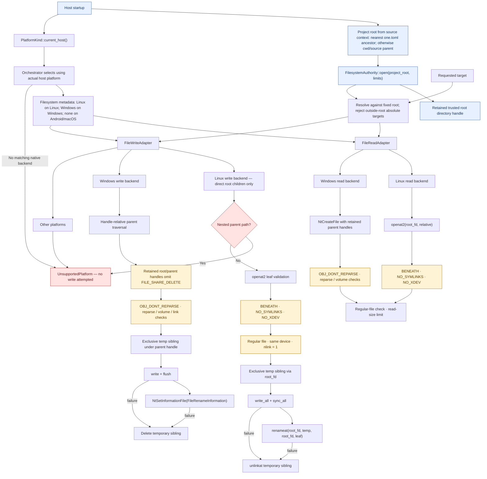

# Filesystem root-confinement architecture (PR #113 candidate)

This focused architecture view documents the filesystem authority and adapter boundary in the unmerged Issue #104 candidate. It is a candidate implementation diagram, not a statement that the capability is released or accepted on `main`.

## Verified implementation mapping

| Diagram component | Source |
|---|---|
| Host-selected project root (source context / nearest `one.toml`), authority injection, and target scope | `crates/one-cli/src/main.rs` |
| Retained root handle, size limits, target normalization | `crates/one-core/src/filesystem.rs` |
| Linux `openat2` read and direct-child atomic write | `crates/one-core/src/filesystem.rs` |
| Windows handle-relative traversal, no-delete-share parent handles, and atomic replacement | `crates/one-core/src/filesystem.rs` |
| Adapter injection and adversarial filesystem tests | `crates/one-core/src/adapter.rs` |
| Normative security and acceptance requirements | `docs/security/issue-104-filesystem-root-confinement-design.md` |
| Exact-SHA adversarial test contract | [`.github/workflows/e4-adversarial-regression.yml`](https://github.com/panglimanetizen01/one-windows-verification/blob/probe/issue-104-platform-metadata-20261120/.github/workflows/e4-adversarial-regression.yml) in the independent verifier repository |

## Explicit limitations

- Linux nested writes fail closed because a retained nested-directory handle can be moved outside the root after opening. Direct-child writes use the retained root handle as their parent authority.
- Linux direct-child and Windows write paths have protected E4 evidence on code-bearing source SHA `722d662e7a81711ba3607d26571f4048a292b3ed` (protected push run #44519577693). Linux nested writes remain fail-closed. The native Windows probe is limited to Windows Server 2025 build 26100.
- Other platforms fail closed.
- A successful artifact build or one passing platform job does not imply full platform support or Issue #104 acceptance.
- The full architecture map in PR #97 is a separate non-normative overview image. This focused source diagram supplements it; it does not claim that the image itself has been visually inspected or reconciled.

## Maintenance rule

When the authority boundary, path resolution, platform backend, write transaction, or failure cleanup changes, update this Mermaid source and the corresponding rendered Markdown view in the same PR. Keep the implementation-status and evidence ledger separate from this architecture description.

## Protected verifier reconciliation — 2026-11-19

PR #44 merged as `a44c32e18f884212c4c9250c4e7a9b8ad1ed9ccd`; protected branch `verification` now pins `722d662e7a81711ba3607d26571f4048a292b3ed`. Protected E4 run #44519577693 succeeded for the Windows native OBJ_DONT_REPARSE probe, Windows reparse/handle checks, and Unix no-follow/resource-bound checks. The native Windows probe evidence is limited to Windows Server 2025 build 26100. Linux nested writes and unsupported platforms remain fail-closed; Issue #104 remains OPEN / NOT ACCEPTED because the fixed-weight release gate has not passed.

## Host-platform selection reconciliation — 2026-11-20

The diagram now includes `PlatformKind::current_host()` and host-specific filesystem adapter metadata. Implementation: `crates/one-core/src/adapter.rs` (`filesystem_platforms`, `PlatformKind::current_host`) and `crates/one-core/src/interpreter.rs` (actual host passed to orchestration). Linux/Windows E4 metadata test and Linux distro integration evidence are recorded above. Android/macOS filesystem adapters remain unsupported; the separate Android runtime proof does not imply filesystem support.
