# Filesystem root-confinement architecture (PR #113 candidate)

This focused architecture view documents the filesystem authority and adapter boundary in the unmerged Issue #104 candidate. It is a candidate implementation diagram, not a statement that the capability is released or accepted on `main`.

```mermaid
flowchart TB
    Host["Host startup"] --> ProjectRoot["Project root from host process current working directory (independent of source and --target)"]
    Host --> HostPlatform["PlatformKind::current_host()"]
    HostPlatform --> SelectAdapter["Orchestrator selects using actual host platform"]
    SelectAdapter --> AdapterMetadata["Filesystem metadata: Linux · Windows · Android · macOS native direct-child backends"]
    ProjectRoot --> Authority["FilesystemAuthority::open(host_cwd, limits) — final-component no-follow + retained-handle identity check"]
    Authority --> Root["Retained trusted root directory handle"]
    RequestedTarget["Requested target"] --> Confine["Resolve against fixed root; reject outside-root absolute targets"]
    Authority --> Confine
    Confine --> ReadAdapter["FileReadAdapter"]
    Confine --> WriteAdapter["FileWriteAdapter"]
    AdapterMetadata --> ReadAdapter
    AdapterMetadata --> WriteAdapter
    SelectAdapter -->|No matching native backend| FailClosed

    ReadAdapter --> LinuxRead["Linux read backend"]
    LinuxRead --> Openat2Read["openat2(root_fd, relative)"]
    Openat2Read --> ReadPolicy["BENEATH · NO_SYMLINKS · NO_XDEV"]
    ReadPolicy --> ReadChecks["Regular-file check · read-size limit"]

    ReadAdapter --> AndroidRead["Android read backend — direct root children only"]
    AndroidRead --> AndroidOpen["openat(root_fd, leaf, O_NOFOLLOW)"]
    AndroidOpen --> AndroidMount["statx(STATX_MNT_ID) · same mount · nlink = 1"]
    AndroidMount --> ReadChecks

    ReadAdapter --> MacosRead["macOS read backend — direct root children only"]
    MacosRead --> MacosOpen["openat(root_fd, leaf, O_NOFOLLOW)"]
    MacosOpen --> MacosVolume["fstatfs f_fsid + mount point · regular file · nlink = 1"]
    MacosVolume --> ReadChecks

    ReadAdapter --> WindowsRead["Windows read backend"]
    WindowsRead --> NtOpen["NtCreateFile with retained parent handles"]
    NtOpen --> WindowsPolicy["OBJ_DONT_REPARSE · reparse / volume checks"]
    WindowsPolicy --> ReadChecks

    WriteAdapter --> LinuxWrite["Linux write backend — direct + guarded nested"]
    LinuxWrite --> Nested{"Nested parent path?"}
    Nested -->|No| LinuxLeaf["openat2 leaf validation under retained root"]
    Nested -->|Yes| LinuxMount["open_tree detached mount clone"]
    LinuxMount --> LinuxNoSymlink["mount_setattr(MOUNT_ATTR_NOSYMFOLLOW)"]
    LinuxNoSymlink --> LinuxNestedParent["openat2 parent beneath detached mount"]
    LinuxNestedParent --> LinuxNestedTemp["Exclusive temp sibling via retained parent handle"]
    LinuxNestedTemp --> LinuxNestedSync["write_all + sync_all"]
    LinuxNestedSync --> LinuxNestedRename["renameat2 within detached parent"]
    LinuxNestedRename --> LinuxNestedDirSync["sync containing directory"]
    LinuxNestedSync -->|failure| LinuxNestedCleanup["unlinkat temp sibling in detached parent"]
    LinuxNestedRename -->|failure| LinuxNestedCleanup
    LinuxMount -->|unsupported primitive| FailClosed["UnsupportedPlatform — no write attempted"]
    LinuxNoSymlink -->|unsupported primitive| FailClosed
    LinuxNestedParent -->|resolution failure| FailClosed
    LinuxLeaf --> LinuxPolicy["BENEATH · NO_SYMLINKS · NO_XDEV"]
    LinuxPolicy --> LinuxType["Regular file · same device · nlink = 1"]
    LinuxType --> LinuxTemp["Exclusive temp sibling via root_fd"]
    LinuxTemp --> LinuxSync["write_all + sync_all"]
    LinuxSync --> LinuxRename["renameat(root_fd, temp, root_fd, leaf)"]
    LinuxSync -->|failure| LinuxCleanup["unlinkat temporary sibling"]
    LinuxRename -->|failure| LinuxCleanup

    WriteAdapter --> AndroidWrite["Android write backend — direct root children only"]
    AndroidWrite --> AndroidLeaf["O_PATH · O_NOFOLLOW · statx mount-ID check"]
    AndroidLeaf --> AndroidTemp["Exclusive temp sibling via root_fd"]
    AndroidTemp --> AndroidSync["write_all + sync_all"]
    AndroidSync --> AndroidRename["renameat(root_fd, temp, root_fd, leaf)"]
    AndroidSync -->|failure| AndroidCleanup["unlinkat temporary sibling"]
    AndroidRename -->|failure| AndroidCleanup

    WriteAdapter --> MacosWrite["macOS write backend — direct root children only"]
    MacosWrite --> MacosLeaf["openat O_NOFOLLOW · st_dev · nlink = 1"]
    MacosLeaf --> MacosTemp["Exclusive temp sibling via root_fd"]
    MacosTemp --> MacosSync["write_all + sync_all"]
    MacosSync --> MacosRename["renameat(root_fd, temp, root_fd, leaf)"]
    MacosSync -->|failure| MacosCleanup["unlinkat temporary sibling"]
    MacosRename -->|failure| MacosCleanup

    WriteAdapter --> WindowsWrite["Windows write backend"]
    WindowsWrite --> WinWalk["Handle-relative parent traversal"]
    WinWalk --> WinShare["Retained root/parent handles omit FILE_SHARE_DELETE"]
    WinShare --> WinPolicy["OBJ_DONT_REPARSE · reparse / volume / link checks"]
    WinPolicy --> WinTemp["Exclusive temp sibling under parent handle"]
    WinTemp --> WinSync["write + flush"]
    WinSync --> WinRename["NtSetInformationFile(FileRenameInformation)"]
    WinSync -->|failure| WinCleanup["Delete temporary sibling"]
    WinRename -->|failure| WinCleanup

    WriteAdapter --> Other["Other platforms"]
    Other --> FailClosed

    classDef trust fill:#e7f0ff,stroke:#315a9b,color:#17345d
    classDef guard fill:#fff3d6,stroke:#a66b00,color:#5c3b00
    classDef blocked fill:#ffe3e3,stroke:#a33,color:#641b1b
    class Host,ProjectRoot,Authority,Root trust
    class ReadPolicy,WindowsPolicy,LinuxPolicy,LinuxType,WinPolicy,WinShare guard
    class FailClosed,Nested blocked
```

## Verified implementation mapping

| Diagram component | Source |
|---|---|
| Host-selected project root (process current working directory), authority injection, and target scope | `crates/one-cli/src/main.rs` |
| Retained root handle, size limits, target normalization | `crates/one-core/src/filesystem.rs` |
| Linux `openat2` read and direct-child atomic write | `crates/one-core/src/filesystem.rs` |
| Android `openat` read and direct-child atomic write with statx mount ID | `crates/one-core/src/filesystem.rs` |
| macOS `openat` read and direct-child atomic write with device identity | `crates/one-core/src/filesystem.rs` |
| Windows handle-relative traversal, no-delete-share parent handles, and atomic replacement | `crates/one-core/src/filesystem.rs` |
| Adapter injection and adversarial filesystem tests | `crates/one-core/src/adapter.rs` |
| Normative security and acceptance requirements | `docs/security/issue-104-filesystem-root-confinement-design.md` |
| Exact-SHA adversarial test contract | [`.github/workflows/e4-adversarial-regression.yml`](https://github.com/panglimanetizen01/one-windows-verification/blob/probe/issue-104-platform-metadata-20261120/.github/workflows/e4-adversarial-regression.yml) in the independent verifier repository |

## Explicit limitations

- Linux nested writes use a guarded detached mount (`open_tree` + `mount_setattr(MOUNT_ATTR_NOSYMFOLLOW)` + `openat2`) so parent movement cannot redirect the final write outside the retained root. The path fails closed when the required kernel/security primitives are unavailable; direct-child writes continue to use the retained root handle.
- Historical Linux direct-child and Windows write evidence on source SHA `722d662e7a81711ba3607d26571f4048a292b3ed` (protected push run #44519577693) does not verify the later detached-mount implementation. The native Windows probe is limited to Windows Server 2025 build 26100.
- Android and macOS support is currently limited to direct children of the retained root. Android requires `statx(STATX_MNT_ID)`; macOS compares `fstatfs` filesystem ID and mount point. Nested paths fail closed. These implementations are code candidates only and have NOT been built or tested.
- Other platforms fail closed.
- A successful artifact build or one passing platform job does not imply full platform support or Issue #104 acceptance.
- The full architecture map in PR #97 is a separate non-normative overview image. This focused source diagram supplements it; it does not claim that the image itself has been visually inspected or reconciled.

## Maintenance rule

When the authority boundary, path resolution, platform backend, write transaction, or failure cleanup changes, update this Mermaid source and the corresponding rendered Markdown view in the same PR. Keep the implementation-status and evidence ledger separate from this architecture description.

## Protected verifier reconciliation — 2026-11-19

PR #44 merged as `a44c32e18f884212c4c9250c4e7a9b8ad1ed9ccd`; protected branch `verification` now pins `722d662e7a81711ba3607d26571f4048a292b3ed`. Protected E4 run #44519577693 succeeded for the Windows native OBJ_DONT_REPARSE probe, Windows reparse/handle checks, and Unix no-follow/resource-bound checks. The native Windows probe evidence is limited to Windows Server 2025 build 26100. Linux nested writes and unsupported platforms remain fail-closed; Issue #104 remains OPEN / NOT ACCEPTED because the fixed-weight release gate has not passed.

## Host-platform selection reconciliation — 2026-11-20

The diagram now includes `PlatformKind::current_host()` and host-specific filesystem adapter metadata. Implementation: `crates/one-core/src/adapter.rs` (`filesystem_platforms`, `PlatformKind::current_host`) and `crates/one-core/src/interpreter.rs` (actual host passed to orchestration). Linux/Windows E4 metadata test and Linux distro integration evidence are recorded above. Android/macOS filesystem adapters remain unsupported; the separate Android runtime proof does not imply filesystem support.

## Exact-source hard-link regression evidence — 2026-11-20

The architecture itself is unchanged by the test-only hard-link increment. The cross-platform regression `filesystem::hardlink_tests::authority_rejects_hard_linked_targets_without_side_effects` now proves that a multiply-linked target is rejected for read and write and that the in-root and outside names retain their original bytes. E4 Linux and Windows jobs passed this test on source SHA `fb5c8bc66a5cbdf8a6670d9d1e9dbe0caa631a20` (verifier run #44651796986). The Mermaid diagram remains the architecture source of truth; no visual node or dependency changed. Linux nested writes and unsupported Android/macOS filesystem adapters remain fail-closed.

## Release-control traceability

The Mermaid diagram above remains the existing architecture source of truth; this release-control update does not change its nodes or security semantics. The prioritized work queue is [ONE_RELEASE_BLOCKER_REGISTER.md](../verification/ONE_RELEASE_BLOCKER_REGISTER.md), and exact-SHA evidence remains in [the evidence matrix](../verification/one-v0.1-evidence-matrix.md). Do not recreate the diagram to represent project status.

## Live implementation update — 2026-11-20 (host-owned filesystem root)

- Candidate PR #113 implementation commit `7cbcb1bf575defe03a2d9991dc5094569de95f03` changes filesystem authority acquisition: Linux now opens the supplied root with `O_DIRECTORY | O_NOFOLLOW | O_CLOEXEC`, validates that the canonical path still identifies the opened directory by device/inode, and fails closed if the path changed during acquisition.
- CLI filesystem authority now comes only from the host process working directory. The source-file path and program-controlled `--target` no longer choose or widen the trusted root. A CLI regression fixture places the `.one` source outside the working directory while reading an in-root target.
- Implementation commits: `8b1d13e02c181fc06b97fb7f147e1ccd013d3aa1` (CLI root binding), `5e39430a341629eb9fda11ee4e11b0f6f40487ab` (CLI fixture), and `7cbcb1bf575defe03a2d9991dc5094569de95f03` (Linux root-handle acquisition).
- This candidate has NOT been built or tested after these changes. Do not transfer prior exact-SHA evidence. Linux nested writes remain fail-closed; Android/macOS filesystem adapters remain unavailable; Issue #104 remains OPEN / NOT ACCEPTED.

## Windows root no-reparse implementation — 2026-11-20

- Windows root acquisition no longer canonicalizes through the final component before opening it. It canonicalizes only the parent, preserves the final name, opens it with the existing `OBJ_DONT_REPARSE` / `FILE_OPEN_REPARSE_POINT` native path, then compares volume serial and file index against the path identity.
- Added `filesystem::windows_root_tests::authority_rejects_reparse_root_without_following_final_component` in commit `8dd92aebc033a94abb14a8d7ec498f6933d4ba8e`; it creates a directory junction and requires root acquisition to fail closed.
- Windows implementation commit: `b208a1a5bdf4a9ffb00a7c17aa4a401ed4a237ce`. This and the Linux/CLI root changes are NOT BUILT OR TESTED. Latest code-bearing candidate: `8dd92aebc033a94abb14a8d7ec498f6933d4ba8e`.
- Preserve Issue #104 OPEN / NOT ACCEPTED. Linux nested writes remain fail-closed; Android/macOS filesystem adapters remain unavailable.

## Android/macOS direct-child implementation update — 2026-11-20

The source diagram now includes the Android and macOS direct-child filesystem candidates. Android requires a kernel-provided statx mount ID to reject mount crossings; macOS compares the opened file's device identity with the retained root. Both use no-follow leaf opens, reject hard links/non-regular files, and replace files through a root-relative temporary sibling plus `fsync` and `renameat`. Nested paths remain fail-closed. Source candidate `4be1b8fd579092d8195c3fb775b7c765f6221814` and its later descendants have NOT been built or tested; Issue #104 remains OPEN / NOT ACCEPTED.

## Platform backend implementation refresh — 2026-11-21

- Linux nested writes now have a guarded detached-mount implementation using `open_tree`, recursive `mount_setattr(MOUNT_ATTR_NOSYMFOLLOW)`, and `openat2` resolution; the operation fails closed when the host kernel/security profile does not permit those primitives. Directory-entry durability syncs the containing directory after atomic replacement.
- Android direct-child operations require `statx(STATX_MNT_ID)` equality. macOS direct-child operations compare `fstatfs` filesystem ID and mount point (not merely `st_dev`). Both reject symlink/hard-link leaves and use exclusive temporary siblings, file sync, directory sync, and `renameat`. Nested Android/macOS paths remain fail-closed.
- New Android/macOS hard-link regressions are in source. Candidate `4c46a41fe45baa7627557a2a25b9c71812840479` is NOT BUILT/TESTED; Issue #104 remains OPEN / NOT ACCEPTED.

## Implementation source refresh — 2026-11-21

- Current code-bearing candidate: `72eae103bc3304b0961c66a0cf61f716ddfa9ac4` (NOT BUILT/TESTED). The diagram's Linux nested-write path now reflects detached-mount cloning, no-symlink mount attributes, parent resolution under the detached mount, atomic rename, and containing-directory sync. Unsupported kernel/security primitives fail closed.
- Android/macOS retain direct-child native read/write candidates; nested paths remain fail-closed. Android mount identity uses `statx(STATX_MNT_ID)`; macOS compares `fstatfs` filesystem ID and mount point.
- The host authority root is exclusively the process working directory. Source path, `one.toml`, and `--target` do not select or widen it.
- Source presence is not acceptance. Issue #104 remains OPEN / NOT ACCEPTED until exact-SHA adversarial evidence is produced. The previous E4 evidence on source `722d662...` does not transfer to this candidate.

## 2026-11-21 — Android/macOS filesystem source repair and confinement boundary

Latest code-bearing source: `0f5859426273a61174d6d1b08ed8771a6f4b136a` (`crates/one-core/src/filesystem.rs`).

- Android's duplicate `create_temp` definition has been removed; macOS now has its missing exclusive `create_temp` helper. Static source inventory shows one helper definition in each native module. No compiler was run.
- Android/macOS direct-child operations retain root-handle-relative no-follow reads and same-directory exclusive-temp atomic replacement; Android requires `statx(STATX_MNT_ID)`, while macOS compares `f_fsid` and mount point with `fstatfs`. Regular-file and hard-link checks remain.
- Nested paths on both POSIX backends explicitly return `UnsupportedPlatform`. Ordinary POSIX directory descriptors do not prevent a parent directory from being renamed outside the retained root, so a multi-component openat walk would not satisfy the root-confinement race contract. No such unsafe nested support is enabled.
- Android/macOS source regressions cover direct-child operation, leaf symlink rejection, nested-path fail-closed behavior, root symlink rejection, and hard-link side-effect preservation. These tests are NOT RUN.
- Issue #104 remains OPEN / NOT ACCEPTED. This source correction is not a build/test/verifier result; no platform support or release approval is promoted.
